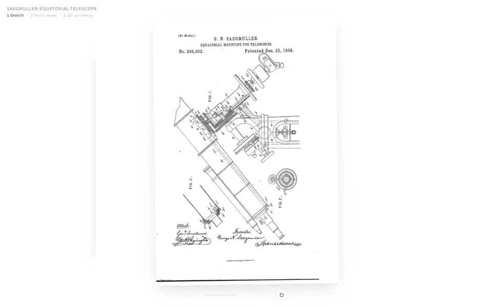
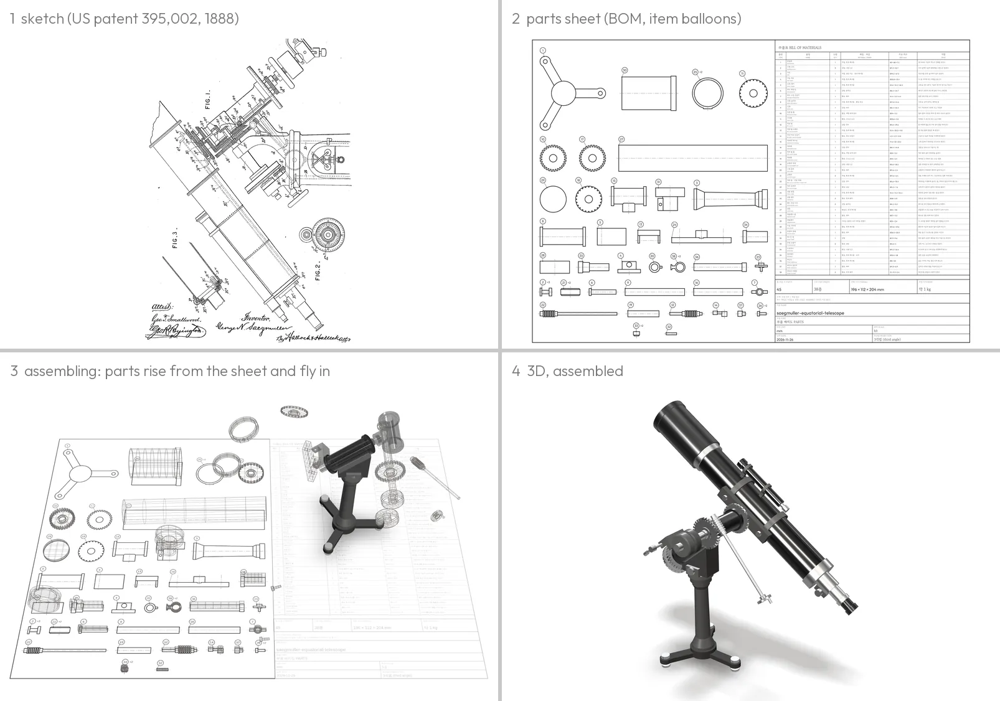
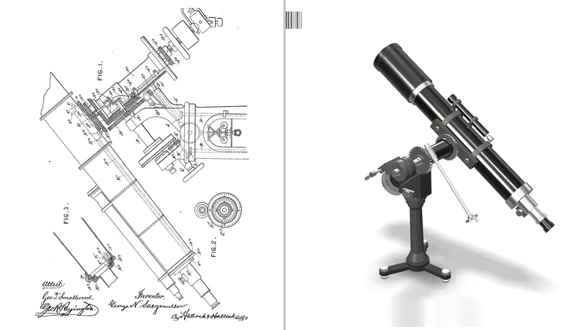

# sketch-to-cad

An AI agent skill that turns one hand sketch into a **dimensioned drawing → 3D model → 3D-print files → single-file HTML viewer**. It asks for dimensions the sketch does not give instead of inventing them.



<sub>Example `saegmuller-telescope` (US Patent 395,002, 1888, 45 parts, 38 unique)</sub>

## What it does

```
sketch image ─▶ read ─▶ ask/assume ─▶ model.json ─▶ ┬ STEP, GLB              (CAD, 3D)
                                                    ├ drawing SVG/PDF        (3 views + isometric, title block; parts sheet + BOM)
                                                    ├ STL, 3MF + print report
                                                    └ viewer/index.html      (single file, offline)
```

1. The agent reads the sketch and writes `intake.json`: parts, dimensions it read, open questions.
2. If the size cannot be determined, it asks **all questions at once**: reference dimension, hidden depth, hollow or solid, printer bed/nozzle.
3. It writes the spec `model.json` (mm, a list of features) and runs `run.py all` to build geometry, drawings, print checks and the viewer. Geometry is computed by [build123d](https://github.com/gumyr/build123d) (OpenCascade).
4. It reports the results together with **every assumed value and print warning**.

**Honesty rule.** Every dimension has an origin:

| origin | meaning |
|---|---|
| `sketch` | read from the sketch |
| `user` | confirmed by the user |
| `assumed` | assumed |

Assumed values are drawn as `(160)*` and listed in `report.md`.

## Example

[examples/saegmuller-telescope/](examples/saegmuller-telescope/): equatorial telescope mount, US Patent 395,002 (1888), public domain ([SOURCE](examples/saegmuller-telescope/SOURCE.md)), 45 parts (38 unique). The original drawing has no dimensions, so the reference size and materials are recorded as assumptions.





Viewers built from this example (download and open in a browser; no network needed):

| file | content |
|---|---|
| [telescope-scroll.html](docs/images/showcase/telescope-scroll.html) | scroll version; adapts to landscape (desktop) and portrait (mobile) |
| [telescope-autoplay.html](docs/images/showcase/telescope-autoplay.html) | autoplay version (about 15 s, `<html data-autoplay>`) |

## Install

**As a Claude Code plugin (recommended)**

```
/plugin marketplace add finddme/sketch-to-cad
/plugin install sketch-to-cad@sketch-to-cad-marketplace
```

**Copy the skill folder only** (into your agent's skills folder, for example `~/.claude/skills/`)

```bash
cp -r skills/sketch-to-cad ~/.claude/skills/
```

**Supported platforms.** Linux/macOS (Windows via WSL or Docker). Python 3.12+ (tested on 3.12).

**First run (once).** Needs Python 3.12+ with venv support (`python3-venv` on Debian/Ubuntu) and network access. Installing the pinned packages takes a few minutes. The agent usually runs this step itself.

On Linux, the CAD kernel also needs the system OpenGL library. Desktop installs usually have it; minimal WSL, servers and containers often do not. `setup` checks for it and tells you if it is missing:

```bash
sudo apt install libgl1        # Debian/Ubuntu/WSL
sudo dnf install mesa-libGL    # Fedora/RHEL
```

```bash
# skill folder copy: installs into .venv inside the skill folder; later commands find it automatically
python3 skills/sketch-to-cad/scripts/run.py setup
# plugin install: keeps the venv in the plugin data folder so it survives updates (SKILL.md fills in this path)
python3 <skill>/scripts/run.py setup --venv ${CLAUDE_PLUGIN_DATA}/venv
```

With `--venv`, pass the same `--venv DIR` (or set `SKETCHCAD_VENV`) to every later command. If a command reports `environment not ready`, the venv is missing or the install was interrupted: run `setup` again.

**With Docker (optional).** If the install fails or Python is older than 3.12, `setup` points you here. Mount the repo at `/skill` and your working folder at `/work`.

```bash
docker build -t sketch-to-cad-dev <repo>
cd <working folder>   # where model.json is
docker run --rm -u "$(id -u)" -v <repo>:/skill -v "$PWD":/work -w /work sketch-to-cad-dev \
  python /skill/skills/sketch-to-cad/scripts/run.py all model.json --out out/<name>
```

**Security.** `model.json` can reference Python code parts (`code` parts) that run locally. Do not build a `model.json` from an unknown source before reading its code parts. The build prints each code file it runs with its sha256.

## Usage

Give the agent a sketch image and ask, for example: "Turn this sketch into a drawing and a model I can 3D print." With the plugin you can also call `/sketch-to-cad:sketch-to-cad` directly. The agent asks for missing information in one batch and writes:

```
out/<name>/
  model.json  manifest.json  report.md          # report: assumptions and warnings
  source/<sketch file>                          # copy of model.json source.images[0].file (when present)
  parts/<id>.step  <id>.glb   assembly.step  assembly.glb
  drawing/<id>.svg  <id>.pdf  assembly.svg  assembly.pdf
          assembly-parts.svg  assembly-parts.pdf  # parts sheet + BOM (two or more parts)
          <id>-notes.svg  <id>-notes.pdf      # notes that did not fit on the drawing (when needed)
  print/<id>.stl  print-plate.3mf  print-report.json  print-report.md
  viewer/index.html
```

### Viewer

`viewer/index.html` is one file. It opens by double-click (`file://`) and needs no network. Scrolling plays the sketch → drawing → 3D story:

| parts | stage labels | what happens |
|---|---|---|
| one | `1 Sketch / 2 Drawing / 3 3D` | the drawing lies on the floor; wires traced on the plan view rise in place and become the solid |
| two or more | `1 Sketch / 2 Parts sheet / 3 3D assembly` | the parts sheet lies on the floor; each part's wires trace its own print, rise, and fly to their seat one by one from the base outward, becoming solid |

- At the end, drag (mouse or touch) to turn the model. The `Explode`/`Assemble` button spreads the parts again.
- `?autoplay=1` plays without scrolling: about 12 s for one part, 15 s for an assembly. Where a query string is not possible, use a copy with `data-autoplay` on its first-line `<html …>` tag.
- If you give a parts list with the sketch (name, material/finish, size, role), it goes into `bom` in `model.json` and onto the parts sheet's BOM.

Embed in a blog or modal:

```html
<iframe src="…/viewer/index.html?autoplay=1" loading="lazy" style="width:100%;aspect-ratio:16/10;border:0"></iframe>
```

### Printing

Load `print/print-plate.3mf` or the per-part STLs into your slicer. This skill does not slice (no G-code).

- Printer values (`bedMm`, `nozzleMm`, `minWallMm`, `overhangDeg`) go in `--printer printer.json`.
- Defaults: 220x220x250 mm bed, 0.4 mm nozzle.
- Check details: [printing.md](skills/sketch-to-cad/references/printing.md).

## Scope and limits

**In scope:** solid objects you can dimension.
- turned parts (cups, knobs), prismatic parts
- extrude, revolve, loft
- holes, fillets/chamfers, shells, linear/circular patterns
- simple multi-part assemblies

**Not supported** (the agent declines with a reason):
- freeform/organic surfaces, motion simulation, sheet-metal unfolding
- tolerance/GD&T manufacturing drawings, building/interior scale
- slicing
- materials, glazes and colors (viewer part colors are a default palette for telling parts apart)

**Known limitations**
- Dimensions derived automatically from feature geometry carry no assumption mark (`*`). Only `dimensions[]`, finish `origin` and `span` entries show an origin.
- In the viewer, shadows under floating mechanism parts can trail oddly.
- Lofts need corresponding corners between sections.
- Threads are not modeled (plain cylinders instead).
- Drawing layout is automatic, so leaders occasionally cross.
- The print check's minimum wall thickness is an estimate.

## Development

Everything runs in Docker; nothing is installed on the host.

```bash
tools/test.sh                                   # default tests (slow ones excluded); builds the image on first run
tools/test.sh -m slow tests/test_examples.py    # full example pipeline (several minutes)

# rebuild the viewer bundle (only developers need Node)
docker run --rm -u "$(id -u)" -v "$PWD":/work -w /work/tools node:24-bookworm \
  sh -c "npm ci && node build-viewer.mjs"

# browser check (desktop/mobile screenshots, rewind, explode toggle, ...)
docker run --rm -u "$(id -u)" -e HOME=/tmp -e PUPPETEER_CACHE_DIR=/home/pptruser/.cache/puppeteer \
  -v "$PWD":/work -w /work ghcr.io/puppeteer/puppeteer \
  node tools/check-viewer.cjs out/<name>/viewer/index.html out/shots
```

The agent instructions (skill body) are in [SKILL.md](skills/sketch-to-cad/SKILL.md).

## License

Code is [MIT](LICENSE). Licenses for the bundled three.js, fonts (Outfit, Gowun Batang: OFL) and Python dependencies are in [THIRD_PARTY.md](THIRD_PARTY.md). The example sketch is public domain, as stated in its `SOURCE.md`.
